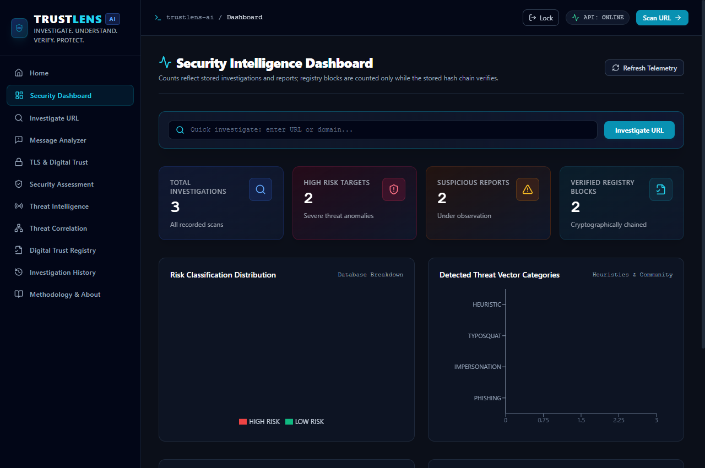
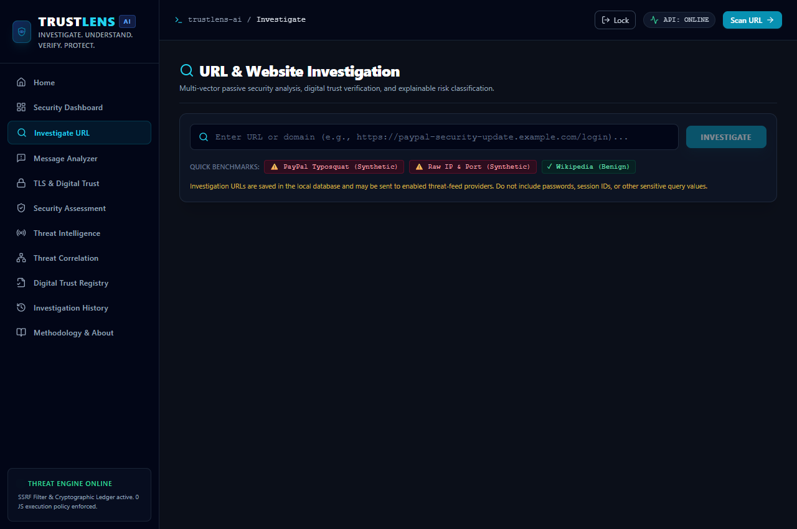
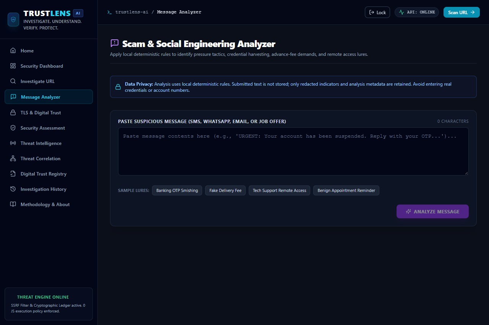
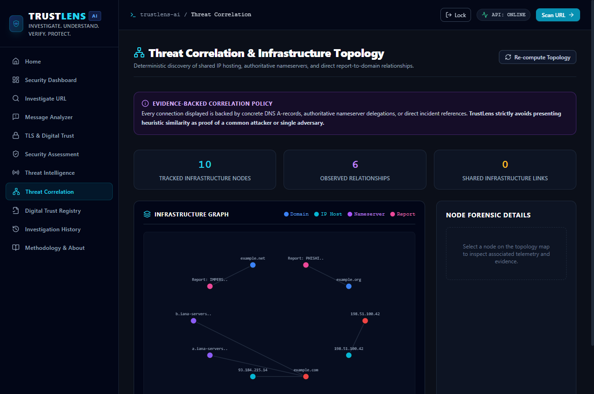
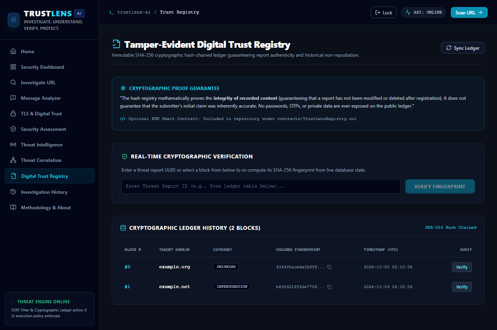
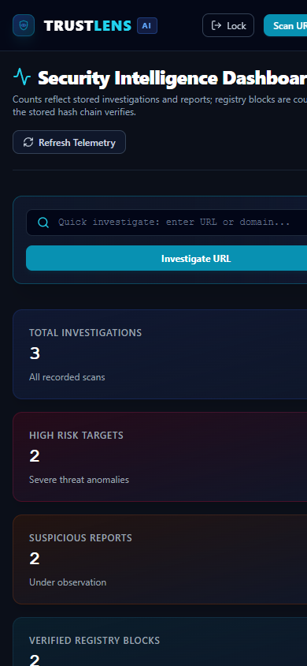

# TrustLens AI
**Explainable web-threat investigation and digital-trust intelligence using bounded passive checks and deterministic analysis.**

## Problem

Phishing and scams use deceptive URLs, redirects, impersonation, and incomplete threat-feed data. HTTPS alone does not prove a site is legitimate, and no threat-feed match is not proof of safety. TrustLens is a decision-support demo that makes evidence and limitations visible while restricting outbound requests to reduce SSRF risk.

## Solution

TrustLens combines URL structure heuristics, bounded DNS and HTTP/TLS inspection, passive security-header analysis, optional external threat intelligence, deterministic scam-message rules, a local report registry, and infrastructure correlations. Findings are evidence-linked and labeled as synthetic, heuristic, or provider-sourced where applicable.

The application does **not** use a trained ML model or runtime LLM. It does not provide a definitive safety verdict.

## Demo links and screenshot

- **Repository:** `https://github.com/ayush2007-star/TrustLens-AI`
- **Live Backend API (Render):** `https://trustlens-api-sidy.onrender.com`
- **Live Health Endpoint:** `https://trustlens-api-sidy.onrender.com/api/health`
- **Live Interactive API Docs:** `https://trustlens-api-sidy.onrender.com/docs`
- **Live Frontend (Vercel):** Configured and ready to link with `VITE_API_BASE_URL=https://trustlens-api-sidy.onrender.com/api`.
- **Local Development:** `http://localhost:5173` (Vite) and `http://127.0.0.1:8000` (FastAPI).

### Genuine Application Screenshots

| Security Dashboard | URL Threat Investigation |
|---|---|
|  |  |

| Scam Message Analyzer | Threat Infrastructure Correlation |
|---|---|
|  |  |

| Digital Trust Registry | Responsive Mobile Experience |
|---|---|
|  |  |

## Tech stack

- **Frontend:** React 18, TypeScript, React Router, Vite 6, Tailwind CSS, Recharts, Axios.
- **Backend:** Python 3.11+, FastAPI, Pydantic, SQLAlchemy, SQLite by default.
- **Analysis:** deterministic URL/message heuristics, DNS metadata, SSRF-guarded passive HTTP, TLS certificate metadata, optional URLhaus/VirusTotal lookup, and a local SHA-256 hash chain.
- **Testing:** pytest and the Vite/TypeScript production build.

## Architecture

The React single-page application calls a FastAPI API. The URL investigation pipeline normalizes input, applies local heuristics, performs bounded DNS/redirect/TLS/header checks, optionally queries configured threat providers, computes a deterministic risk classification, and stores the result in SQLAlchemy-backed persistence. TLS-only and security-header-only actions use separate non-persisting endpoints.

Message analysis is deterministic and stores redacted metadata, not submitted message text. Community reports and investigations are stored in the configured database. The registry is a local tamper-evident hash chain, not a public blockchain or independent trust anchor. See [architecture](./docs/ARCHITECTURE.md) and [security methodology](./docs/SECURITY_METHODOLOGY.md).

## Setup and run steps

### Prerequisites

- Python 3.11 or newer.
- Node.js 20 or newer and npm.

### Backend (from repository root)

```powershell
python -m venv .venv
.\.venv\Scripts\Activate.ps1
python -m pip install -r backend\requirements.txt
Copy-Item .env.example .env
$env:PYTHONPATH = "backend"
python -m uvicorn app.main:app --host 127.0.0.1 --port 8000 --reload
```

For Linux/macOS, activate with `source .venv/bin/activate`, copy `.env.example` to `.env`, set `PYTHONPATH=backend`, then run the same Uvicorn module and port.

### Frontend

```powershell
Set-Location frontend
npm ci
npm run dev
```

Open `http://localhost:5173`. Vite proxies `/api` to `http://127.0.0.1:8000`. For a separately hosted API, set `VITE_API_BASE_URL` to its HTTPS API base ending in `/api` in the frontend build environment. See [frontend/.env.example](./frontend/.env.example).

### Environment variables

The backend reads `.env` from its working directory. Copy the root [.env.example](./.env.example) to `.env` and configure only what is needed.

| Variable | Purpose |
|---|---|
| `HOST`, `PORT` | Backend bind address and port. Use `0.0.0.0` only behind a correctly configured public deployment. |
| `ENVIRONMENT` | Runtime environment. In `production`, startup requires `APP_ACCESS_TOKEN` of at least 32 characters. |
| `CORS_ORIGINS` | JSON array of allowed browser origins; set the actual frontend origin for deployment. CORS is not authentication. |
| `APP_ACCESS_TOKEN` | Optional shared bearer token for all `/api/*` data endpoints other than health. Keep it secret; users sharing it share access to the same data. It is not per-user authorization. |
| `DATABASE_URL` | SQLAlchemy database URL. Defaults to local SQLite; production must use storage with verified persistence and backups. |
| `REQUEST_TIMEOUT_SECONDS`, `MAX_REDIRECTS`, `MAX_RESPONSE_BYTES` | Bounds for outbound inspection requests. |
| `COMMUNITY_WRITES_ENABLED` | Keeps community report writes disabled by default. |
| `COMMUNITY_ABUSE_KEY` | Required by the optional community-write controls; not a user login. |
| `VIRUSTOTAL_API_KEY` | Optional VirusTotal credential; never commit a real key. |
| `URLHAUS_API_ENABLED` | Enables/disables URLhaus checks. When enabled, submitted URLs may be sent to that provider. |
| `VITE_API_BASE_URL` | Optional frontend build-time API URL; unset uses Vite's local `/api` proxy. |

Never put private URLs, tokens, credentials, or real API keys into public demo inputs. The API stores submitted investigation URLs, and enabled threat providers may receive them. Do not expose a production deployment without access controls, abuse protections, HTTPS, and verified persistent database storage. The shared token is a coarse demo gate, not multi-user privacy.

### Verification commands

Run backend tests from repository root against an isolated database so the configured local database is not changed:

```powershell
$env:PYTHONPATH = "backend"
$env:DATABASE_URL = "sqlite:///./trustlens-test.db"
python -m pytest backend\tests -v
```

Run the frontend checks from `frontend`:

```powershell
npm run build
npm audit
```

The test API module initializes and seeds its configured database at import; use a disposable test database and remove it after testing. Test/build results for this workspace are recorded in [docs/TESTING_REPORT.md](./docs/TESTING_REPORT.md).

## Disclosures (libraries, templates, AI tools)

- Runtime analysis is deterministic and rule-based. No trained ML model or LLM is used to produce threat classifications.
- Synthetic reserved-domain fixtures are examples, not live observations.
- URLhaus is an external provider integration; VirusTotal is optional by API key. PhishTank and OpenPhish are not live integrations.
- Submitted investigation URLs are stored and may be sent to enabled threat-intelligence providers. Message text is analyzed locally; the stored message record contains redacted indicator metadata.
- Third-party libraries include React, React Router, Vite, Tailwind CSS, Recharts, Axios, FastAPI, SQLAlchemy, Pydantic, `cryptography`, `dnspython`, and `httpx`.
- GitHub Copilot was used as an AI coding assistant. No user study, external validation, or production threat-detection accuracy claim is made.
- The Solidity registry source is a standalone demonstrator and is not deployed or called by the web application.

## Track

**AI-Powered Web Threat Detection & Digital Trust Intelligence**

The current application fits the digital-trust and explainable threat-intelligence portions of the track. Its current analyzer is heuristic, not AI/ML; a genuinely evaluated ML component remains future work.

## Demo video

No demo video has been recorded or uploaded. Use the truthful, maximum-three-minute walkthrough in [docs/DEMO_SCRIPT.md](./docs/DEMO_SCRIPT.md), then add the real video URL here after recording.
