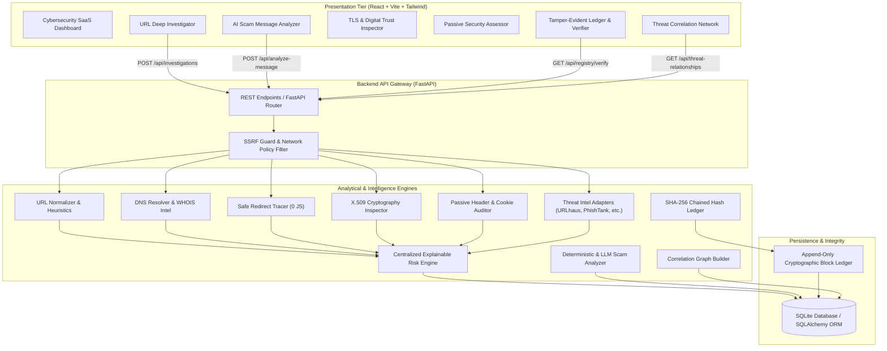

# TrustLens AI – AI-Powered Web Threat Detection & Digital Trust Intelligence

> **Tagline:** Investigate. Understand. Verify. Protect.  
> An intelligent cybersecurity platform that investigates phishing URLs, inspects real TLS certificates, analyzes social engineering messages, correlates threat infrastructure, and cryptographically anchors collaborative reports in an immutable tamper-evident ledger.

---

## 1. Project Name & Description

**TRUSTLENS AI** is an explainable digital trust and threat intelligence platform designed to uncover deceptive web infrastructure. It dismantles the widespread false sense of security surrounding the HTTPS "lock icon", exposes brand typosquatting and deceptive URL encoding, evaluates passive website security posture without intrusive exploits, dissects social engineering lures with deterministic and AI engines, and provides mathematical non-repudiation for community threat reports via a SHA-256 hash-chained registry.

---

## 2. Problem

Modern digital threats increasingly exploit systemic cognitive blind spots in web security:

1. **The HTTPS Legitimacy Fallacy:** Over 80% of active phishing websites now operate over valid, trusted HTTPS certificates. Users are trained to equate the browser lock icon with safety, yet a valid certificate only verifies in-transit encryption and hostname ownership—never business honesty or legitimacy.
2. **The 72-Hour Zero-Day Window:** Newly registered phishing domains and targeted smishing campaigns remain unindexed by global threat feeds during their initial dissemination window. Relying solely on external blocklists leaves victims vulnerable.
3. **Black-Box, Inactionable Scores:** Generic security tools output arbitrary percentages without transparent, explainable evidence or specific remediation guidance.
4. **Scanner Exploitation & SSRF Risks:** Naive URL analysis tools that blindly fetch user-submitted links expose backend infrastructure to Server-Side Request Forgery (SSRF) and cloud metadata exfiltration.
5. **Report Integrity Vulnerabilities:** Centralized threat databases lack non-repudiation, making it impossible to cryptographically verify whether a recorded incident report was altered after submission.

---

## 3. Solution

TrustLens AI delivers an end-to-end, defense-in-depth investigation platform:

- **Intelligent URL & Deception Heuristics:** Identifies high-value brand typosquatting (e.g. PayPal, Chase, Microsoft), Punycode/IDN homoglyph lookalikes (`xn--`), raw IP authorities, non-standard service ports, and embedded user credentials.
- **SSRF-Protected Safe Redirect Tracing:** Audits redirect chains step-by-step with `follow_redirects=False`. Validates every destination hop against private/loopback/cloud-metadata CIDRs before opening connections. **Strictly avoids executing JavaScript.**
- **Real X.509 TLS Certificate Inspection:** Establishes native cryptographic handshakes to inspect Subject Alternative Names (SANs), CA issuer authorities, signature algorithms, public key modulus, remaining validity days, and hostname mismatches.
- **Passive Website Security Posture:** Non-intrusively evaluates HSTS, CSP, X-Frame-Options clickjacking defenses, X-Content-Type-Options, cookie security flags, and RFC 9116 `security.txt` accessibility without active probing.
- **AI Scam & Social Engineering Analyzer:** Dissects SMS, WhatsApp, and email messages for artificial urgency, OTP/credential solicitation, irreversible payment demands, and remote administration tools (AnyDesk, TeamViewer), backed by a deterministic fallback that runs 100% offline.
- **Threat Correlation Topology:** Visualizes interconnected infrastructure clusters (co-hosted IPs, authoritative nameservers, and campaign targets) supported by deterministic DNS records.
- **Tamper-Evident Digital Trust Registry:** An append-only cryptographic ledger chaining canonical report payloads via SHA-256. Any historical alteration to a report triggers instant `TAMPER_DETECTED` verification alerts. Includes an EVM Solidity smart contract demonstrator (`contracts/TrustLensRegistry.sol`).

---

## 4. Demo Links and Screenshot

- **Web Dashboard:** [http://localhost:5173](http://localhost:5173)
- **Interactive REST API Documentation:** [http://localhost:8000/docs](http://localhost:8000/docs)
- **API Health Endpoint:** [http://localhost:8000/api/health](http://localhost:8000/api/health)

### Terminal & Web UI Preview
```
+---------------------------------------------------------------------------------------+
|  TRUSTLENS AI  [Dashboard] [Investigate URL] [Message Analyzer] [TLS Trust] [Ledger]  |
+---------------------------------------------------------------------------------------+
|  TARGET: https://paypal-security-update.example.com/login?token=urgent                |
|  RISK CLASSIFICATION: [ HIGH RISK ] (Threat Score: 85/100) - Confidence: HIGH         |
|                                                                                       |
|  [!] Brand Impersonation Detected: High-value brand 'PAYPAL' in host 'example.com'    |
|  [!] Sensitive Action Keywords: Clustered authentication tokens ['login', 'update']   |
|  [!] TLS Certificate Mismatch: Subject 'example.com' does not match target host       |
|  [!] Missing Security Headers: No HSTS or Content-Security-Policy configured          |
|                                                                                       |
|  CRYPTOGRAPHIC LEDGER: Block #0 [SHA-256: 31a388641140...] -> VERIFIED AUTHENTIC      |
+---------------------------------------------------------------------------------------+
```

---

## 5. Tech Stack

### Frontend
- **Framework:** React 18 with TypeScript
- **Build Tool:** Vite 5
- **Styling:** Tailwind CSS (Custom Dark Cybersecurity Palette `#0B0F19`, `#111827`, `#06B6D4`, `#3B82F6`)
- **Navigation:** React Router v6
- **Icons:** Lucide React
- **Data Visualization:** Recharts
- **HTTP Client:** Axios

### Backend
- **Runtime:** Python 3.11+ (Tested on Python 3.13)
- **Framework:** FastAPI + Starlette
- **Data Modeling & Validation:** Pydantic v2 + Pydantic-Settings
- **ORM & Persistence:** SQLAlchemy 2 + SQLite
- **Cryptography & TLS:** Python `cryptography` (X.509 parsers) + `ssl`
- **DNS Resolution:** `dnspython`
- **HTTP & Passive Auditing:** `httpx` (async/sync HTTP client)
- **Testing:** `pytest` + `pytest-asyncio` + FastAPI TestClient

### Smart Contract / Web3 (Demonstrator)
- **Language:** Solidity `^0.8.20`
- **Contract:** `contracts/TrustLensRegistry.sol` (EVM compatible)

---

## 6. Architecture



---

## 7. Setup and Run Steps

TrustLens AI requires **no paid API keys** and operates out-of-the-box on a clean machine.

### Prerequisites
- Python 3.11+
- Node.js v18+ and npm

### 1. Clone & Environment Setup
```bash
git clone https://github.com/bakt2/TrustLens-AI.git
cd TrustLens-AI

# Create Python Virtual Environment
python -m venv .venv

# Activate Virtual Environment
# On Windows (PowerShell):
.\.venv\Scripts\Activate.ps1
# On Linux/macOS:
# source .venv/bin/activate

# Install Backend Dependencies
pip install -r backend/requirements.txt
```

### 2. Frontend Dependencies
```bash
cd frontend
npm install
cd ..
```

### 3. Run Backend Server
```bash
# From repository root with virtualenv active:
# On Windows PowerShell:
$env:PYTHONPATH="backend"
python -m uvicorn app.main:app --host 127.0.0.1 --port 8000 --reload

# On Linux/macOS:
# PYTHONPATH=backend python -m uvicorn app.main:app --host 127.0.0.1 --port 8000 --reload
```
*Backend API initializes tables and seeds benchmark dataset automatically at [http://127.0.0.1:8000](http://127.0.0.1:8000).*

### 4. Run Frontend Dashboard
```bash
# In a separate terminal:
cd frontend
npm run dev
```
*Open [http://localhost:5173](http://localhost:5173) in your browser.*

### 5. Run Verification & Test Suite
```bash
# Run backend test suite (16 tests covering heuristics, SSRF, TLS, registry, and APIs):
$env:PYTHONPATH="backend"
pytest backend/tests -v

# Run production frontend build:
cd frontend
npm run build
```

---

## 8. Disclosures (Libraries, Templates, AI Tools)

- **Third-Party Libraries Used:**
  - `FastAPI`, `Starlette`, `Uvicorn`, `Pydantic v2`, `SQLAlchemy`, `cryptography`, `dnspython`, `python-whois`, `httpx`, `pytest`.
  - `React 18`, `Vite`, `Tailwind CSS`, `React Router DOM`, `Lucide React`, `Recharts`, `Axios`.
- **Public Threat Intelligence Feeds:**
  - abuse.ch URLhaus public lookup API.
  - PhishTank community feed format.
  - OpenPhish community heuristics.
  - VirusTotal v3 API (optional integration enabled when `VIRUSTOTAL_API_KEY` is present).
- **AI Coding Assistants & Templates:**
  - Scaffolding initialized using standard Vite React-TS template.
  - Code authored with assistance from Google DeepMind Antigravity AI engineering agent.
  - No proprietary or copyrighted company code utilized. All brand marks and logos are original custom SVGs.

---

## 9. Track

**Hackathon Track:** Cybersecurity, Digital Trust & AI Safety / Web3 Public Good.

---

## 10. Demo Video

**3-Minute Live Video Walkthrough Script:** (See detailed breakdown in [`docs/DEMO_SCRIPT.md`](docs/DEMO_SCRIPT.md))

- **0:00 – 0:15:** The Problem: Over 80% of phishing sites use valid HTTPS. Explaining the Digital Trust Fallacy.
- **0:15 – 0:55:** Live Investigation: Analyzing `https://paypal-security-update.example.com/login?token=urgent`. Typosquatting detection, SSRF-safe redirect tracing, and explainable risk classification (85/100).
- **0:55 – 1:20:** TLS & Security Posture: Demonstrating real X.509 cert SAN extraction, hostname mismatch detection, and passive HTTP header auditing without intrusive exploits.
- **1:20 – 1:45:** AI Scam Message Analysis: Testing SMS smishing and fake delivery lures with deterministic pattern evaluation and OTP harvesting detection.
- **1:45 – 2:20:** Threat Intel & Infrastructure Correlation: Submitting collaborative community threat reports and inspecting the connected topology graph.
- **2:20 – 2:45:** Cryptographic Trust Registry: Verifying SHA-256 block fingerprints in the immutable hash chain, demonstrating single-byte tamper detection.
- **2:45 – 3:00:** Conclusion: Highlighting clean-machine setup, zero-paid-API requirement, and production-grade engineering honesty.
