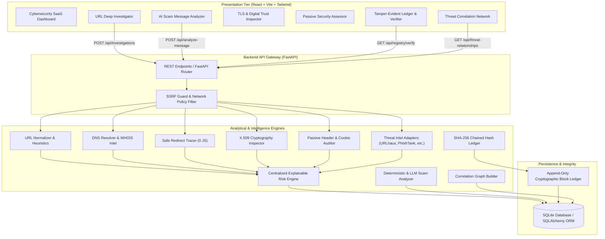

# TrustLens AI — System Architecture & Design Specification

> **Tagline:** Investigate. Understand. Verify. Protect.  
> **Mission:** Explainable web threat intelligence, TLS digital trust validation, scam message heuristics, and cryptographic tamper-evident reporting.

---

## 1. High-Level Architecture Overview

TrustLens AI is structured as a modular, low-latency, defense-in-depth security intelligence platform. It decouples passive network probes and heuristic engines from the user-facing presentation tier, orchestrating investigations across 6 specialized security micro-services.

---

## 2. Multi-Stage Pipeline Breakdown

### Stage 1: URL Normalization & Obfuscation Detection
- Canonicalizes scheme, authority, path, and query strings.
- Strips default ports (`:80`, `:443`).
- Detects IP-address-based authorities, Punycode/IDN homoglyph confusables (`xn--`), embedded credentials (`user:pass@host`), and excessive subdomains.
- Evaluates typosquatting against high-value banking, tech, and logistics brands.

### Stage 2: DNS & Domain Intelligence
- Dispatches asynchronous lookups via `dnspython` for A, AAAA, MX, NS, and TXT records.
- Flags suspicious configurations (NXDOMAIN, excessive A-record rotation, missing MX on institutional claims).
- Queries WHOIS metadata for domain registration age, registrar, and expiration status. Explicitly returns `"Not available"` when data cannot be retrieved.

### Stage 3: SSRF-Guarded Redirect Tracing
- Executes step-by-step redirect navigation with `follow_redirects=False`.
- Resolves each hop destination through `ssrf_guard.py` before initiating sockets.
- Blocks loopback (`127.0.0.0/8`), private IPv4 (`10.0.0.0/8`, `172.16.0.0/12`, `192.168.0.0/16`), link-local (`169.254.0.0/16`), multicast (`224.0.0.0/4`), and IPv6 ULA/loopback (`::1`, `fc00::/7`).
- Imposes strict thresholds: Maximum 5 redirects, 8-second timeout, 1 MB response limit.
- **Strictly avoids executing JavaScript.**

### Stage 4: Real TLS Certificate & Digital Trust Inspection
- Establishes native SSL/TLS handshake socket to port 443 with SNI.
- Extracts DER-encoded certificate and parses X.509 structures via Python `cryptography`.
- Validates:
  - Exact validity window (`not_before`, `not_after`, days remaining).
  - Subject and Issuer Distinguished Names.
  - Subject Alternative Names (SANs) with wildcard resolution.
  - Signature algorithm and public key modulus/curve size.
  - Active TLS protocol version (`TLSv1.2`, `TLSv1.3`).
- **Core Truth:** "A valid HTTPS certificate verifies encryption and host binding; it never proves business legitimacy or honesty."

### Stage 5: Passive Website Security Posture
- Queries HTTP headers passively without intrusive vulnerability probes.
- Evaluates:
  - `Strict-Transport-Security` (HSTS)
  - `Content-Security-Policy` (CSP)
  - `X-Frame-Options` / Clickjacking defense
  - `X-Content-Type-Options` (nosniff)
  - `Referrer-Policy`
  - Cookie security flags (`Secure`, `HttpOnly`, `SameSite`)
  - Public `robots.txt` and `/.well-known/security.txt` accessibility (RFC 9116).

### Stage 6: Threat Intelligence & Explainable Risk Engine
- Queries URLhaus, PhishTank, OpenPhish, and VirusTotal (when key provided).
- Distinguishes **MALICIOUS**, **NO RECORD FOUND**, and **UNAVAILABLE** (never equates missing feed data with safety).
- Synthesizes all vectors into one deterministic, explainable risk score (0-100) and classification (`LOW RISK`, `SUSPICIOUS`, `HIGH RISK`, `CONFIRMED MALICIOUS`, `INCONCLUSIVE`).

### Stage 7: Tamper-Evident Digital Trust Registry
- Implements an append-only cryptographic ledger with SHA-256 hash chaining:
  - **Canonical Payload:** Deterministic, whitespace-normalized, sorted JSON representation.
  - **Data Hash:** `SHA-256(canonical_payload)`
  - **Chained Hash:** `SHA-256(block_index : previous_hash : data_hash : timestamp)`
- Offers instantaneous verification: Re-computes hashes against the stored block to detect even single-character tampering or ledger chain corruption.
- Accompanied by a complete Solidity smart contract demonstrator (`TrustLensRegistry.sol`).
