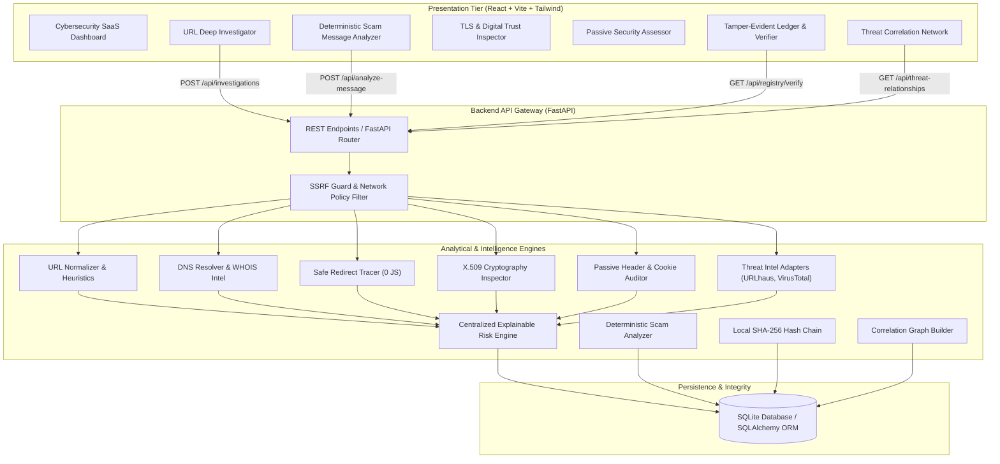

# TrustLens AI — System Architecture & Design Specification

> **Tagline:** Investigate. Understand. Verify. Protect.  
> **Mission:** Explainable web threat intelligence, TLS digital trust validation, scam message heuristics, and cryptographic tamper-evident reporting.

---

## 1. High-Level Architecture Overview

TrustLens AI is a modular React/FastAPI application, not a set of independently deployed microservices. The API coordinates URL heuristics, metadata lookups, bounded target checks, local message rules, correlation, and registry operations.

---

## 2. Multi-Stage Pipeline Breakdown

### Stage 1: URL Normalization & Obfuscation Detection
- Canonicalizes scheme, authority, path, and query strings.
- Strips default ports (`:80`, `:443`).
- Detects IP-address-based authorities, Punycode/IDN homoglyph confusables (`xn--`), embedded credentials (`user:pass@host`), and excessive subdomains.
- Evaluates typosquatting against high-value banking, tech, and logistics brands.

### Stage 2: DNS & Domain Intelligence
- Queries A, AAAA, MX, NS, and TXT records via `dnspython`.
- Flags an absence of address records and unusually large A-record sets.
- Queries WHOIS metadata for domain registration age, registrar, and expiration status. Explicitly returns `"Not available"` when data cannot be retrieved.

### Stage 3: SSRF-Guarded Redirect Tracing
- Executes step-by-step redirect navigation with `follow_redirects=False`.
- Resolves each hop through `ssrf_guard.py` and rejects failed DNS or any non-globally-routable answer.
- Pins target HTTP/TLS sockets to a validated IP address; HTTP Host and TLS SNI still use the hostname.
- Checks every redirect destination before connecting.
- Imposes strict thresholds: Maximum 5 redirects, 8-second timeout, 1 MB response limit.
- **Strictly avoids executing JavaScript.**

### Stage 4: TLS Certificate Metadata & Digital Trust Inspection
- Establishes a native TLS handshake socket to the URL's port (default 443 for HTTPS), pinned to a validated IP, with hostname verification and SNI.
- Extracts DER-encoded certificate and parses X.509 structures via Python `cryptography`.
- Validates:
  - Exact validity window (`not_before`, `not_after`, days remaining).
  - Subject and Issuer Distinguished Names.
  - Subject Alternative Names (SANs).
  - Signature algorithm and public key modulus/curve size.
  - Active TLS protocol version (`TLSv1.2`, `TLSv1.3`).
- The app does not report negotiated cipher suites or inspect/validate a separately supplied certificate chain.
- **Core Truth:** "A valid HTTPS certificate verifies encryption and host binding; it never proves business legitimacy or honesty."

### Stage 5: Passive Website Security Posture
- Makes bounded ordinary HTTP requests to inspect headers; it does not run intrusive vulnerability probes.
- Evaluates:
  - `Strict-Transport-Security` (HSTS)
  - `Content-Security-Policy` (CSP)
  - `X-Frame-Options` / Clickjacking defense
  - `X-Content-Type-Options` (nosniff)
  - `Referrer-Policy`
  - Cookie security flags (`Secure`, `HttpOnly`, `SameSite`)
  - Public `robots.txt` and `/.well-known/security.txt` accessibility (RFC 9116).

### Stage 6: Threat Intelligence & Explainable Risk Engine
- Queries URLhaus when enabled and VirusTotal when an API key is configured. PhishTank and OpenPhish are not live integrations.
- Distinguishes **MALICIOUS**, **NO RECORD FOUND**, and **UNAVAILABLE** (never equates missing feed data with safety).
- Synthesizes all vectors into one deterministic, explainable risk score (0-100) and classification (`LOW RISK`, `SUSPICIOUS`, `HIGH RISK`, `CONFIRMED MALICIOUS`, `INCONCLUSIVE`).

### Stage 7: Tamper-Evident Digital Trust Registry
- Stores a local database hash chain with SHA-256:
  - **Canonical Payload:** Deterministic, whitespace-normalized, sorted JSON representation.
  - **Data Hash:** `SHA-256(canonical_payload)`
  - **Chained Hash:** `SHA-256(block_index : previous_hash : data_hash : timestamp)`
- Verification recomputes report payloads and checks the full stored chain. This is tamper-evident, but a database administrator can rewrite the complete database.
- The Solidity file is a standalone demonstrator; this application does not deploy or call it.

## Message analyzer and data handling

Message analysis is deterministic and local; no generative AI service is called. Submitted text is not retained. The API stores redacted indicator metadata, while the immediate response may include short evidence excerpts.

## Access control and standalone assessments

When `APP_ACCESS_TOKEN` is configured, the API requires a bearer token for `/api/*` data endpoints other than `/api/health`. Production startup requires a token of at least 32 characters. This is a shared access gate, not user accounts or per-record authorization; token holders can access the same stored data. TLS-only and passive-security-only POST routes call their corresponding analysis services without creating investigation records.
